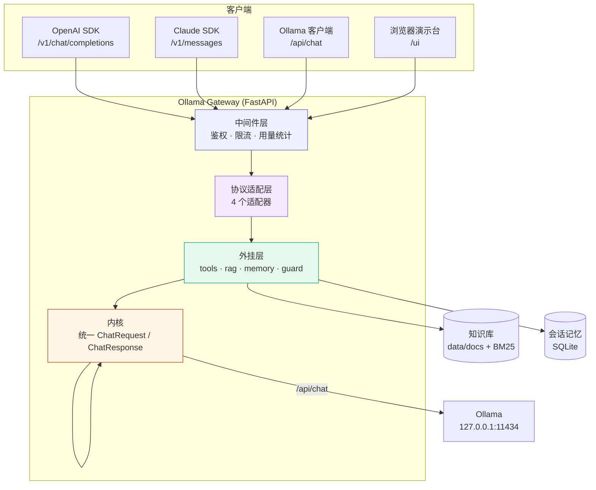
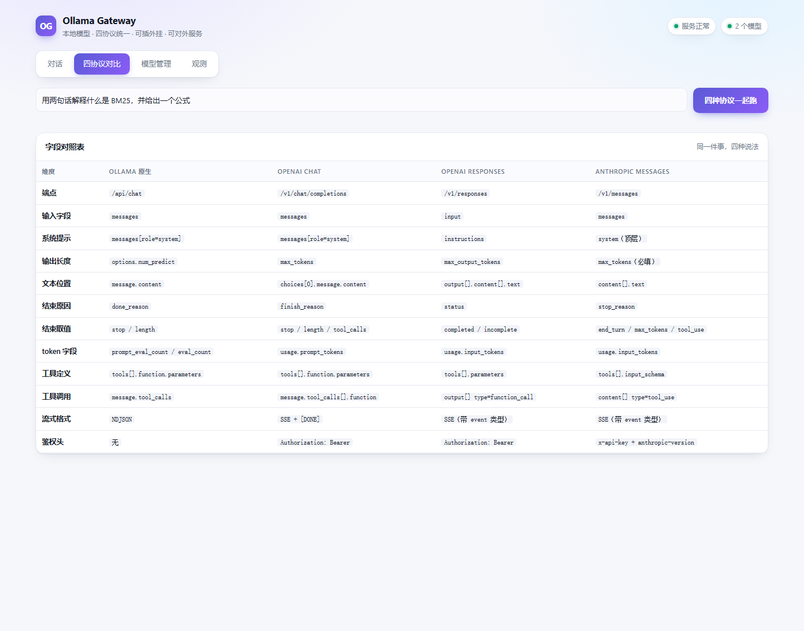

# Ollama Gateway

> 把本地 Ollama 变成一个**能对外提供服务**的 LLM 网关。
> 一套内核，同时说 **Ollama / OpenAI Chat Completions / OpenAI Responses / Anthropic Messages** 四种话，
> 并支持 **工具调用 / 知识库检索 / 会话记忆 / 输入护栏** 四种外挂。

[](https://www.python.org/)
[](https://fastapi.tiangolo.com/)
[](LICENSE)
[](tests/)

---

## 一、这个项目解决什么问题

Ollama 本身很好用，但它离"一个能被别人调用的服务"还差四步：

| 缺口 | 后果 | 本项目的做法 |
|---|---|---|
| **没有鉴权** | `OLLAMA_HOST=0.0.0.0` 一开，局域网里谁都能白嫖你的显卡 | API Key 中间件（Bearer / x-api-key 两种传法） |
| **没有限流** | 一个人写个死循环就能把队列占满 | 滑动窗口限流，**只卡烧 GPU 的推理端点** |
| **协议只有一种** | 用 Claude SDK 的客户端接不上，用 OpenAI SDK 的又要改代码 | 四种协议同开，服务端做翻译 |
| **模型是"哑"的** | 只会说话，查不了时间、算不了数、不知道你的私有文档 | 工具调用 + 知识库检索 + 会话记忆 + 护栏 |

同时，它还把"四种调用方式到底差在哪"这件事，做成了一个**可以亲手跑出对比**的东西 ——
不用背文档，敲一次 `/api/compare`，同一个问题四种协议的回答、字段结构、token 统计并排摊开给你看。

---

## 二、架构



**关键设计：只做一层内部模型。**
四个协议适配器各自负责「外部格式 ⇄ 内部格式」的翻译，外挂只写一遍，内核只认识一种消息结构。
加第五种协议时，只需要再写一个适配器，不用动任何其他代码。

### 演示台

项目自带一个零依赖单文件演示台（`web/index.html`），四个页签：对话、四协议对比、模型管理、观测。



---

## 三、快速开始

### 1. 准备 Ollama 和模型

```bash
# 确保 ollama 在跑
ollama serve

# 下载模型（1.5B 约 1GB，CPU 也能跑）
python scripts/pull_models.py qwen2.5:1.5b
python scripts/pull_models.py --list      # 看已装模型
```

> 想要**工具调用**能力，模型必须带 `tools` 能力（`qwen2.5:*` 有，`qwen2:*` 没有）。
> 用 `python scripts/pull_models.py --list` 可以看到 `capabilities` 一列。

### 2. 装依赖、起服务

```bash
python -m venv .venv
.venv/Scripts/pip install -r requirements.txt      # Windows
# pip install -r requirements.txt                    # Linux / macOS

.venv/Scripts/python run.py                          # 默认 http://127.0.0.1:8000
```

### 3. 打开演示台

浏览器访问 **http://127.0.0.1:8000/ui** —— 可以切协议、开外挂、看原始响应 JSON、拉模型、查用量。

### 4. 用 SDK 接

```python
from openai import OpenAI

client = OpenAI(base_url="http://127.0.0.1:8000/v1", api_key="dummy")   # 无鉴权时随便填
resp = client.chat.completions.create(
    model="qwen2.5:1.5b",
    messages=[{"role": "user", "content": "现在几点了？"}],
    extra_body={"augmentations": ["tools"]},      # 打开工具调用
)
print(resp.choices[0].message.content)
```

Anthropic SDK 同理，把 `base_url` 指到 `http://127.0.0.1:8000` 即可（网关实现了 `/v1/messages`）。

---

## 四、四种调用方式的区别（核心）

这是本项目最想讲清楚的一件事。同一个模型，四个协议在**十一个维度**上都不同：

| 维度 | Ollama API | OpenAI Chat | OpenAI Responses | Anthropic Messages |
|---|---|---|---|---|
| 端点 | `/api/chat` | `/v1/chat/completions` | `/v1/responses` | `/v1/messages` |
| 输入字段 | `messages` | `messages` | `input` | `messages` |
| 系统提示 | `messages[role=system]` | `messages[role=system]` | `instructions`（**顶层**） | `system`（**顶层**） |
| 输出长度 | `options.num_predict` | `max_tokens` | `max_output_tokens` | `max_tokens`（**必填**） |
| 文本位置 | `message.content` | `choices[0].message.content` | `output[].content[].text` | `content[].text` |
| 结束原因 | `done_reason` | `finish_reason` | `status` | `stop_reason` |
| 结束取值 | `stop` / `length` | `stop` / `length` / `tool_calls` | `completed` / `incomplete` | `end_turn` / `max_tokens` / `tool_use` |
| token 统计 | `prompt_eval_count` / `eval_count` | `usage.prompt_tokens` | `usage.input_tokens` | `usage.input_tokens` |
| 工具定义 | `tools[].function.parameters` | `tools[].function.parameters` | `tools[].parameters`（**扁平**） | `tools[].input_schema` |
| 工具调用 | `message.tool_calls` | `message.tool_calls[].function` | `output[]` type=`function_call` | `content[]` type=`tool_use` |
| 流式格式 | **NDJSON** | SSE + `[DONE]` | SSE（带 `event` 类型） | SSE（带 `event` 类型） |
| 鉴权头 | 无 | `Authorization: Bearer` | `Authorization: Bearer` | `x-api-key` + `anthropic-version` |

**亲手验证，而不是背表格：**

```bash
curl -X POST http://127.0.0.1:8000/api/compare \
  -H "Content-Type: application/json" \
  -d '{"prompt":"用两句话解释什么是 BM25","max_tokens":220}'
```

返回里会同时给出四种协议的**原始请求体、原始响应体、耗时、token 数**，
以及上面那张对照表。演示台的「四协议对比」页就是它的可视化版本。

### 流式的差别最容易被忽略

Ollama 用的是 **NDJSON**（一行一个 JSON，不带 `data:` 前缀），而另外三家都是 SSE。
所以如果你要写一个能同时吃四种流的客户端，光读 `data:` 前缀是不够的：

```python
# Ollama NDJSON
{"model":"...","message":{"role":"assistant","content":"数"},"done":false}

# OpenAI SSE
data: {"object":"chat.completion.chunk","choices":[{"delta":{"content":"数"}}]}

# Anthropic SSE（带事件类型）
event: content_block_delta
data: {"type":"content_block_delta","index":0,"delta":{"type":"text_delta","text":"数"}}
```

---

## 五、四种外挂

外挂是**声明式**的：在任意协议的请求体里加 `augmentations` 数组即可，不加就是裸模型。

```json
{ "model": "qwen2.5:1.5b", "messages": [...], "augmentations": ["guard", "rag", "tools", "memory"] }
```

| 外挂 | 干什么 | 实现要点 |
|---|---|---|
| **`guard`** 护栏 | 脱敏手机号/身份证/邮箱，拦截超长输入 | 正则脱敏 + 字符数上限，超限直接 413 |
| **`rag`** 知识库 | 把 `data/docs/` 里的文档检索出来注入上下文 | 纯 Python BM25，**不需要 embedding 模型**，中英双语分词 |
| **`tools`** 工具调用 | 模型自己决定调 `get_current_time` / `calculate` / … | 工具注册表 + 多轮循环，最多 `max_tool_rounds` 轮 |
| **`memory`** 会话记忆 | 同一 `session_id` 的历史自动拼回上下文 | SQLite 落库，跨进程重启不丢 |

### 工具调用的完整链路

```
用户提问
  → 网关注入 tools 定义 → 调 Ollama
  → 模型返回 tool_calls: [{name:"get_current_time", arguments:{}}]
  → 网关真的去执行（AST 白名单求值 / 系统时间 / BM25 检索 …）
  → 把结果作为 role=tool 消息追加 → 再次调 Ollama
  → 模型根据工具结果给出最终回答
```

内置工具：`get_current_time` `calculate` `search_documents` `read_note` `list_models` `get_weather`。
加新工具只要往 `TOOL_REGISTRY` 里塞一条。

### 知识库为什么用 BM25 而不是向量检索

向量检索要额外下载 embedding 模型、装向量库，链路长。BM25 纯 CPU、毫秒级、零依赖，
而且对**专有名词、编号、术语**的召回反而更准。
本项目的中文处理是「字符 unigram + bigram」，并且**查询侧只发 bigram**
（否则"量子纠缠"会因为单字"相"命中"相关性"而拿到假分 —— 这是单元测试逼出来的修正）。

---

## 六、作为对外服务

### 开启鉴权与限流

```bash
cp .env.example .env
# .env 里填：
OG_API_KEYS=sk-xxxxxxxx,sk-yyyyyyyy
OG_RATE_LIMIT_PER_MINUTE=60
```

- Key 传法：`Authorization: Bearer <key>` 或 `x-api-key: <key>`，多个 Key 逗号分隔
- 限流是**滑动窗口**，按 Key 分桶；**只作用于推理端点**（`/api/chat`、`/v1/*`、`/api/compare`），
  查模型列表、看用量这些管理接口不占额度
- 401 / 403 / 429 的错误体也按各协议风格返回，客户端 SDK 能正确解析

### 运维接口

| 接口 | 说明 |
|---|---|
| `GET /healthz` | 存活探针 |
| `GET /readyz` | 就绪探针（含可用模型列表、知识库状态） |
| `GET /stats` | 用量统计：分协议的请求数、token、平均延迟 |
| `GET /api/models` | 已装模型列表（含 capabilities） |
| `POST /api/models/pull` | 下载模型，SSE 实时进度 |
| `GET /api/knowledge` · `POST /api/knowledge` | 知识库状态 / 写入文档 |
| `GET /api/sessions` | 会话列表（memory 外挂） |
| `POST /api/compare` | 四协议对比实验 |
| `GET /docs` | 自动生成的 OpenAPI 文档 |

---

## 七、项目结构

```
ollama-gateway/
├── app/
│   ├── main.py               # FastAPI 装配、中间件、异常处理
│   ├── config.py             # 配置（pydantic-settings，支持 .env）
│   ├── schemas.py            # 内部统一模型 ChatRequest / ChatResponse
│   ├── ollama_client.py      # 上游客户端：/api/chat、模型管理、NDJSON 流解析
│   ├── middleware.py         # 鉴权 · 滑动窗口限流 · 用量统计
│   ├── protocols/             # ★ 四个协议适配器
│   │   ├── base.py
│   │   ├── ollama_native.py
│   │   ├── openai_chat.py
│   │   ├── openai_responses.py
│   │   └── anthropic_messages.py
│   ├── augment/              # ★ 四个外挂
│   │   ├── __init__.py       # 流水线装配：prepare / run / run_stream
│   │   ├── tools.py          # 工具注册表 + 执行循环
│   │   ├── rag.py            # BM25 检索
│   │   ├── memory.py         # SQLite 会话记忆
│   │   └── guard.py          # PII 脱敏 + 长度限制
│   └── routers/
│       ├── gateway.py        # 四个对外协议端点
│       └── admin.py          # 模型 / 知识库 / 会话 / 用量 / 对比
├── web/index.html            # 演示台（零依赖单文件）
├── scripts/
│   ├── pull_models.py        # 走 HTTP API 拉模型
│   └── selftest.py           # 外挂端到端自检
├── tests/
│   ├── test_protocols.py     # 协议翻译的纯逻辑测试
│   ├── test_augment.py       # 分词 / 检索 / 护栏 / 工具安全
│   └── smoke.py              # 打真实服务的冒烟测试
├── data/docs/                # 知识库目录（放 .md / .txt 即可）
└── docs/
    ├── protocols.md          # 四协议逐字段详解
    └── augmentations.md      # 外挂实现详解
```

---

## 八、测试

```bash
# 单元测试（不需要模型，41 个用例，<1 秒）
.venv/Scripts/python -m pytest

# 端到端自检（需要 ollama 在跑）
.venv/Scripts/python scripts/selftest.py

# 冒烟测试（需要网关在跑）
.venv/Scripts/python tests/smoke.py --base http://127.0.0.1:8000

# 顺带验证鉴权与限流（另起一个带 key 的实例）
OG_API_KEYS=secret123 OG_RATE_LIMIT_PER_MINUTE=3 \
  .venv/Scripts/python -m uvicorn app.main:app --port 8001
.venv/Scripts/python tests/smoke.py --base http://127.0.0.1:8001 --key secret123 --test-ratelimit
```

---

## 九、部署

```bash
docker compose up -d --build
```

- `Dockerfile`：Python 3.12-slim，多阶段构建
- `docker-compose.yml`：网关 + Ollama 两个服务，网关通过 `OLLAMA_BASE_URL` 指向 Ollama 容器
- 生产环境建议：网关前面挂 Nginx/Caddy 做 TLS，Key 走环境变量注入，限流值按显卡产能调

---

## 十、已知限制

- **工具调用质量取决于模型**。1.5B 小模型偶尔会漏调工具或参数给错，2B+ 或专门做过 function calling 训练的模型更稳。
- **`get_weather` 是 mock 数据**，明确标注了来源，不联网。
- **会话记忆没有压缩**，长对话会一直累积 token；生产环境该加摘要或滑窗。
- **BM25 只做字面召回**，换个说法就召不回；想要语义召回就换向量检索，接口留好了。
- **单机部署**，没有多副本的限流协调（需要 Redis 之类）。

---

## 十一、许可

MIT —— 见 [LICENSE](LICENSE)。

模型权重遵循各模型自身的许可证，本仓库不包含任何模型文件。
